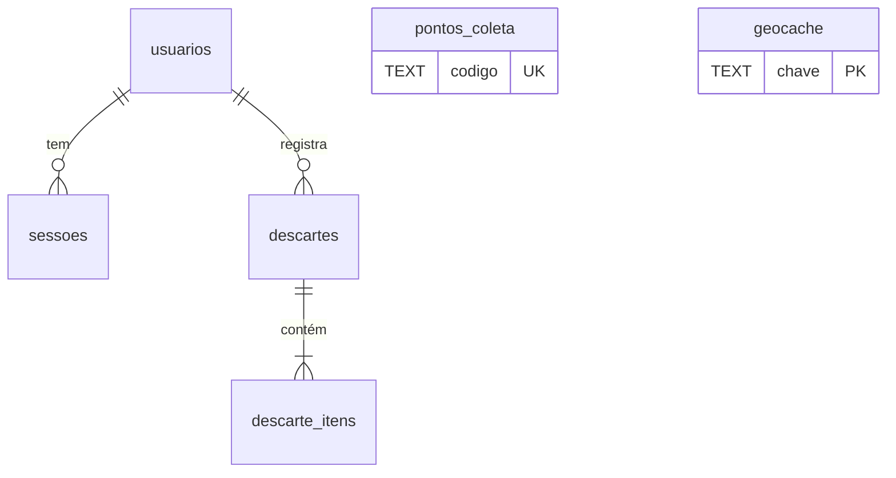

# Banco de dados do Descarte Certo

Guia para quem vai mexer no banco (pessoas e assistentes de IA). Descreve **como o banco está feito hoje**
e **o padrão a seguir** em qualquer mudança. Tudo o que está aqui vem de `servidor.js`, conferido com o banco
em produção em 20/11/2026.

> Leia também: [PROJETO.md](PROJETO.md) (como o projeto todo é feito) e a seção
> "Para assistentes de IA" do [README](../README.md#para-assistentes-de-ia-leia-antes-de-mudar-qualquer-coisa).

## Resumo

| Item | Como é |
|---|---|
| Motor | **SQLite**, pelo módulo nativo `node:sqlite` (`DatabaseSync`) do Node 22.5 ou mais novo. Sem ORM e sem pacote npm. |
| Onde o código fica | Tudo em `servidor.js`: criação das tabelas, migrações, consultas e rotas da API. Não há pasta de migrações. |
| Arquivo do banco | Local: `data/descarte.db`. Produção: `/opt/descarte-certo/data/descarte.db` (variável `DB_PATH`). |
| Modo | `PRAGMA journal_mode = WAL` e `PRAGMA foreign_keys = ON`, ativados toda vez que o servidor inicia. |
| Criação | O próprio servidor cria tudo ao iniciar, com `CREATE TABLE IF NOT EXISTS`. Um banco novo nasce vazio, com os pontos de coleta carregados do JSON. |
| Versionamento | `data/` e `*.db` estão no `.gitignore`. O banco **nunca** vai para o git. |

Em produção, em 20/11/2026: 2 usuários, 2 sessões, 0 descartes, 244 linhas em `pontos_coleta` (222 ativas e
22 desativadas na revisão de 20/11) e 4 entradas em `geocache`. **São dados reais de pessoas, protegidos pela LGPD.**

## Relações



- `usuarios` → `sessoes`, `descartes` → `descarte_itens`: chaves estrangeiras com **`ON DELETE CASCADE`**.
  Apagar um usuário apaga as sessões, os descartes e os itens dele (é assim que funciona "Excluir minha conta").
- `pontos_coleta` e `geocache` não se ligam a nenhuma outra tabela.
- `descartes.ponto` guarda o **nome** do ponto como texto, sem chave para `pontos_coleta`. Isso é de propósito:
  o descarte pode ser num ponto do OpenStreetMap (fora da Grande Vitória) que não existe na tabela, e o histórico
  continua certo mesmo se o ponto for desativado depois.

## Tabelas

### `usuarios`

| Coluna | Tipo | Regras |
|---|---|---|
| `id` | INTEGER PRIMARY KEY | rowid do SQLite |
| `nome` | TEXT NOT NULL | 2 a 60 caracteres (validado na rota) |
| `email` | TEXT NOT NULL UNIQUE COLLATE NOCASE | gravado em minúsculas; até 120 caracteres |
| `senha_hash` | TEXT NOT NULL | formato `scrypt$<sal em hex>$<hash em hex>` (sal de 16 bytes, hash de 64) |
| `criado_em` | TEXT NOT NULL DEFAULT `datetime('now')` | data do cadastro, em UTC |
| `privacidade_aceita_em` | TEXT | data do aceite do aviso de privacidade (gravada no cadastro). *Coluna de migração.* |
| `recuperacao_hash` | TEXT | hash do código de recuperação de senha, no mesmo formato `scrypt$…`. `NULL` = conta sem código. *Migração.* |
| `recuperacao_criado_em` | TEXT | quando o código atual foi gerado. *Migração.* |

- A senha e o código de recuperação **nunca** são guardados em texto: só o hash scrypt com sal.
  A comparação usa `crypto.timingSafeEqual`. Quando o e-mail não existe, o servidor compara com `HASH_FALSO`
  para gastar o mesmo tempo e não revelar quais e-mails têm conta.
- O código de recuperação tem 12 caracteres do alfabeto `ABCDEFGHJKLMNPQRSTUVWXYZ23456789` (sem I, O, 0 e 1),
  mostrado ao usuário como `XXXX-XXXX-XXXX`. Antes de conferir, ele é normalizado (maiúsculas, sem hífens).
- Trocar a senha pelo código apaga todas as sessões do usuário e gera um código novo; o usado deixa de valer.

### `sessoes`

| Coluna | Tipo | Regras |
|---|---|---|
| `token_hash` | TEXT PRIMARY KEY | **SHA-256 em hex** do token do cookie. O token em si nunca é guardado. |
| `usuario_id` | INTEGER NOT NULL → `usuarios(id)` ON DELETE CASCADE | |
| `criado_em` | TEXT NOT NULL DEFAULT `datetime('now')` | |
| `expira_em` | **INTEGER** NOT NULL | milissegundos desde 1970 (`Date.now() + 30 dias`), para comparar direto com `Date.now()` |

- O token tem 32 bytes aleatórios (`base64url`) e vai no cookie `dc_sessao`: `HttpOnly`, `SameSite=Lax`,
  `Max-Age` de 30 dias, `Path=COOKIE_PATH` (`/descarte-certo/` em produção) e `Secure` quando `COOKIE_SECURE=1`.
- Sessões vencidas são apagadas ao iniciar e depois a cada hora.

### `descartes`

| Coluna | Tipo | Regras |
|---|---|---|
| `id` | INTEGER PRIMARY KEY | |
| `usuario_id` | INTEGER NOT NULL → `usuarios(id)` ON DELETE CASCADE | índice `idx_descartes_usuario` |
| `ponto` | TEXT NOT NULL | nome do ponto, até 120 caracteres (padrão: "Ponto de coleta") |
| `peso_kg` | REAL NOT NULL | soma de `quantidade × peso_unit_kg` dos itens, **calculada no servidor** e arredondada em 3 casas |
| `criado_em` | TEXT NOT NULL DEFAULT `datetime('now')` | |

### `descarte_itens`

| Coluna | Tipo | Regras |
|---|---|---|
| `id` | INTEGER PRIMARY KEY | |
| `descarte_id` | INTEGER NOT NULL → `descartes(id)` ON DELETE CASCADE | índice `idx_itens_descarte` |
| `nome` | TEXT NOT NULL | até 60 caracteres (nome do item do catálogo ou digitado pela pessoa) |
| `quantidade` | INTEGER NOT NULL | 1 a 999 |
| `peso_unit_kg` | REAL NOT NULL | maior que 0 e até 200 |

Até 50 itens por descarte. Itens inválidos são descartados na rota. O descarte e os itens são gravados numa
**transação** (`BEGIN` / `COMMIT`, com `ROLLBACK` em caso de erro).

### `pontos_coleta`

Espelho do arquivo **`pontos/pontos-grande-vitoria.json`**, que é a fonte da verdade.

| Coluna | Tipo | Regras |
|---|---|---|
| `id` | INTEGER PRIMARY KEY | |
| `codigo` | TEXT NOT NULL UNIQUE | identificador estável do ponto (ex.: `vix-central-servicos-resistencia`) |
| `nome`, `endereco`, `cidade` | TEXT NOT NULL | |
| `bairro`, `horario`, `telefone`, `fonte_url`, `fonte_data`, `observacao` | TEXT | texto vazio quando não há |
| `uf` | TEXT NOT NULL DEFAULT `'ES'` | |
| `lat`, `lon` | REAL NOT NULL | |
| `aceita` | TEXT NOT NULL | **lista JSON** de categorias do OpenStreetMap (`["batteries","mobile_phones",…]`) |
| `confianca` | TEXT | `alta` = fonte oficial recente; `media`/`baixa` = o site pede para confirmar antes de ir |
| `ativo` | INTEGER NOT NULL DEFAULT 1 | 1 = aparece no site; 0 = saiu do arquivo |
| `atualizado_em` | TEXT NOT NULL DEFAULT `datetime('now')` | |

- Toda vez que o servidor inicia, `sincronizarPontos()` marca **todos** como `ativo = 0` e faz upsert
  (`INSERT … ON CONFLICT(codigo) DO UPDATE`) de cada ponto do JSON com `ativo = 1`, numa transação.
  Pontos que saíram do arquivo ficam desativados, nunca apagados.
- **Não edite esta tabela direto.** Para incluir, corrigir ou remover um ponto, edite o JSON e reinicie o servidor.
- O JSON tem dois campos que **não** vão para o banco: `geo_precisao` e `nota_pesquisa` (anotações da pesquisa).
- Categorias usadas hoje em `aceita`: `batteries`, `mobile_phones`, `computers`, `electrical_items`,
  `electrical_appliances`, `tv_monitor`, `white_goods`, `cables`, `printer_cartridges`, `low_energy_bulbs`,
  `fluorescent_tubes`. Os nomes em português ficam em `CATEGORIAS` (`web/src/dados.js`).

### `geocache`

Cache de CEPs e endereços já convertidos em coordenadas, para não repetir consultas aos serviços externos.

| Coluna | Tipo | Regras |
|---|---|---|
| `chave` | TEXT PRIMARY KEY | `cep:<8 dígitos>` ou `q:<texto sem acento, em minúsculas, com espaços simples>` |
| `lat`, `lon` | REAL NOT NULL | |
| `rotulo` | TEXT NOT NULL | endereço mostrado no site ("Perto de …") |
| `fonte` | TEXT NOT NULL | `awesomeapi`, `viacep+nominatim` ou `nominatim` |
| `criado_em` | TEXT NOT NULL DEFAULT `datetime('now')` | |

Não tem ligação com usuário nem com IP (o aviso de privacidade promete isso). Não há expiração.
A localização do navegador ("Usar minha localização") **não** é gravada em lugar nenhum.

## Padrão do código (siga sempre)

1. **Nomes em português**, `snake_case`, tabelas no plural. Chave primária `id INTEGER PRIMARY KEY`.
   Chave estrangeira `<entidade>_id` com `ON DELETE CASCADE` quando o dado só existe por causa do dono.
2. **Datas** em TEXT com `datetime('now')`: UTC no formato `AAAA-MM-DD HH:MM:SS`. Na resposta da API, converta
   para ISO com `Z` usando `isoUtc()` (ou `.replace(" ", "T") + "Z"`). Exceção: `sessoes.expira_em`, em
   milissegundos (INTEGER).
3. **Booleanos** em INTEGER 0/1. **Listas** em TEXT com JSON (`JSON.stringify` ao gravar, `JSON.parse` ao ler).
   **Pesos** em kg (REAL).
4. **Toda consulta é um prepared statement** no objeto `sql` de `servidor.js`, com parâmetros `?`.
   Nunca monte SQL juntando texto vindo do usuário. (`garantirColuna` interpola nomes de tabela e coluna,
   mas só recebe constantes do próprio código.)
5. **Valide antes de gravar**, na rota: `texto(valor, max)` para strings, limites numéricos explícitos e
   e-mail com `EMAIL_OK`. Erros voltam como `{ "erro": "mensagem em português" }` com o status HTTP certo.
6. **Escritas em mais de uma tabela** vão numa transação: `db.exec("BEGIN")`, depois `COMMIT`, e `ROLLBACK`
   no `catch` (com `throw err` de novo).
7. **Nunca devolva colunas de hash** nem dados de outros usuários. Use `publico(u)` para o usuário e
   `historicoDe(id)` para o histórico. Estatísticas da comunidade são só totais somados.
8. **Segredos e senhas** sempre com `hashSenha()` / `conferirSenha()` (scrypt + sal). Tokens, com `sha256()`.

## Como mudar o banco

| Quero… | Faça assim |
|---|---|
| Criar uma tabela | Acrescente `CREATE TABLE IF NOT EXISTS …` (e os índices) no bloco `db.exec` do início de `servidor.js`. |
| Criar uma coluna numa tabela que já existe | **Não basta mudar o `CREATE TABLE`**: no banco de produção a tabela já existe e o `IF NOT EXISTS` não a altera. Acrescente `garantirColuna("tabela", "coluna", "TIPO")` logo depois das outras chamadas. A coluna precisa aceitar `NULL` ou ter `DEFAULT`. |
| Renomear ou apagar coluna, mudar tipo | Não há migração automática para isso. Evite. Se for mesmo necessário, explique no PR: o dono faz à mão, com backup. |
| Nova consulta | Acrescente ao objeto `sql`, com `?` nos valores. |
| Ponto de coleta | Edite `pontos/pontos-grande-vitoria.json`, não a tabela. |
| Guardar um dado pessoal novo | Atualize também o aviso de privacidade (`web/src/privacidade/main.jsx`), porque ele lista tudo o que é guardado (LGPD). |

Para testar:

```bash
node servidor.js
```

Faça isso uma vez com um banco **novo** (apague `data/descarte.db` antes) e outra com um banco **antigo**,
para ver a migração funcionando (`Coluna criada: …` aparece no terminal).
Contas de teste só no banco local, nunca em produção.

No PR, avise que `servidor.js` mudou. A API é publicada separadamente do site e, em produção, o dono faz
backup do banco antes de reiniciar o serviço `descarte-certo-api`.

## Nunca faça

- Versionar `data/`, `*.db`, `*.db-wal` ou `*.db-shm`, ou colar dados do banco em issue, PR ou log.
- Acessar, copiar ou alterar o banco de produção. Você não tem acesso à VPS e não deve pedir.
- Guardar a localização do usuário, ligar buscas de CEP a pessoas ou criar rastreamento.
- Apagar linhas de `pontos_coleta` (desative tirando do JSON).

## Rotas da API e tabelas

| Rota | Login | Lê | Escreve |
|---|---|---|---|
| `GET /api/saude` | não | — | — |
| `GET /api/estatisticas` | não | `descartes` (totais) | — |
| `GET /api/localizar?q=` | não | `geocache` | `geocache` |
| `GET /api/pontos?lat=&lon=&limite=` | não | `pontos_coleta` (só `ativo = 1`) | — |
| `GET /api/me` | opcional | `sessoes`, `usuarios`, `descartes`, `descarte_itens` | — |
| `POST /api/cadastro` | não | `usuarios` | `usuarios`, `sessoes` |
| `POST /api/login` | não | `usuarios` | `sessoes` |
| `POST /api/logout` | opcional | — | `sessoes` (apaga) |
| `POST /api/recuperar` | não | `usuarios` | `usuarios`, `sessoes` (apaga as antigas e cria uma) |
| `POST /api/recuperacao/codigo` | sim | `sessoes` | `usuarios` |
| `POST /api/descartes` | sim | `sessoes` | `descartes`, `descarte_itens` |
| `DELETE /api/conta` | sim | `sessoes` | `usuarios` (apaga, em cascata) |
