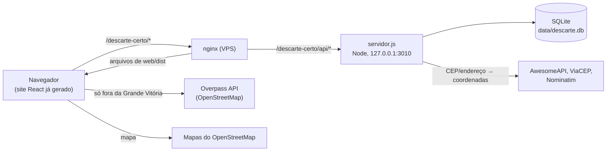

# Como o Descarte Certo é feito

Guia para quem vai mexer no código (pessoas e assistentes de IA). Explica **como o projeto está montado hoje**,
**onde fica cada coisa** e **o padrão a seguir** para que uma mudança nova pareça ter sido feita pelo mesmo autor.

> Leia também: [BANCO.md](BANCO.md) (o banco de dados em detalhe) e a seção
> "Para assistentes de IA" do [README](../README.md#para-assistentes-de-ia-leia-antes-de-mudar-qualquer-coisa)
> (fluxo de branch e PR, o que não fazer).

## O que é

Site de extensão universitária (PEI II, Multivix) que incentiva o descarte correto de lixo eletrônico na Grande
Vitória (ES). A pessoa escolhe os aparelhos que tem em casa, vê o peso aproximado e encontra os 5 pontos de coleta
mais próximos. Ter conta é opcional e serve para guardar o histórico de descartes. No ar em
<https://technologyhm.com.br/descarte-certo/>.

## Arquitetura



- **Front-end**: React 18 + Mantine 7 + ícones `lucide-react`, gerado pelo Vite. Vira arquivos estáticos (`web/dist`).
- **Back-end**: um único arquivo, `servidor.js`, em Node puro (sem `npm install`), com API JSON e banco SQLite.
- Os dois são **publicados separadamente**: o site vai para `/var/www/descarte-certo/` e a API roda como serviço
  systemd `descarte-certo-api` em `/opt/descarte-certo/`. Só o dono publica (veja o README).

## Pastas e arquivos

```
descarte-certo/
├── servidor.js                  API + banco + arquivos do site nos testes locais (tudo do back-end)
├── testes/                      testes da API com node:test (banco temporário, nunca o data/)
├── pontos/
│   └── pontos-grande-vitoria.json   pontos de coleta pesquisados (fonte da verdade; vai para o banco ao iniciar)
├── data/                        banco SQLite local (criado sozinho; fora do git)
├── docs/
│   ├── PROJETO.md               este guia
│   └── BANCO.md                 guia do banco de dados
├── web/                         site (Vite + React + Mantine)
│   ├── index.html               página inicial      → src/inicio/main.jsx
│   ├── conta.html               Minha área          → src/conta/main.jsx
│   ├── privacidade.html         aviso de privacidade → src/privacidade/main.jsx
│   ├── vite.config.js           3 entradas, base "./", proxy /api → localhost:5173
│   └── src/
│       ├── config.js            configurações editáveis (FORM_URL, RAIO_PADRAO_KM)
│       ├── dados.js             catálogo de itens (nome, ícone, peso, tags) e nomes das categorias
│       ├── comum/
│       │   ├── Raiz.jsx         tema do Mantine, notificações e função avisar()
│       │   ├── Moldura.jsx      Cabecalho (topo com menu ☰) e Rodape
│       │   ├── Janelas.jsx      ModalConta (cadastro/login/recuperar), ModalCodigo, CodigoGrande, Confirmar
│       │   ├── api.js           apiFetch(): única forma de chamar a API
│       │   └── util.js          fmtKg, fmtKm, fmtData, distanciaKm, store (localStorage), fetchJson, primeiroNome
│       ├── inicio/
│       │   ├── main.jsx         página inicial: estado, conta, registrar descarte
│       │   ├── Secoes.jsx       Hero, PorQue, Avaliacao
│       │   ├── Calculadora.jsx  itens, "outro item" e barra de resumo
│       │   ├── Pontos.jsx       busca (localização/CEP), 5 pontos, alternativas
│       │   ├── Mapa.jsx         mapa Leaflet (carregado só quando abre)
│       │   └── osm.js           busca no OpenStreetMap (Overpass) fora da Grande Vitória
│       ├── conta/main.jsx       Minha área: abas Minha conta e Histórico
│       └── privacidade/main.jsx texto do aviso de privacidade (LGPD)
├── README.md, CLAUDE.md, AGENTS.md
└── .gitignore                   data/, *.db, node_modules/, web/dist/, .claude/
```

## Front-end (`web/`)

### Padrão visual

- **Use os componentes do Mantine** (`Button`, `Card`, `Paper`, `SimpleGrid`, `Group`, `Stack`, `Title`, `Text`,
  `Modal`, `Tabs`, `Badge`, `ThemeIcon`…) e as *style props* (`c`, `bg`, `fz`, `fw`, `p`, `mt`, `w`…).
  Não há arquivos CSS próprios: não crie. Use `style={{ … }}` só para o que o Mantine não cobre.
- **Tema** em `web/src/comum/Raiz.jsx`: cor principal `verde` (tom 7 = `#1a8a63`, tom 9 = `#0b3b2e` em títulos e
  faixas escuras), fonte Plus Jakarta Sans, cantos `md`, botões arredondados (`radius: "xl"`) e `Badge` sem
  caixa-alta. Use as cores do tema (`c="verde.9"`, `bg="verde.0"`, `color="red"`), nunca hex solto.
- **Ícones** só do `lucide-react`, normalmente dentro de `ThemeIcon` (variant `light` ou `filled`). Emojis só em
  textos de aviso, não como ícone.
- **Responsivo**: valores por tamanho (`fz={{ base: 28, md: 36 }}`, `cols={{ base: 1, sm: 2, lg: 3 }}`) e
  `visibleFrom` / `hiddenFrom`. Teste com 390 px de largura (celular). O topo (`Cabecalho`) **nunca quebra linha**:
  abaixo de 1200 px os links vão para o menu ☰ (`menuExtra` recebe o que não couber, como Entrar, Sair e Histórico).
- **Seções** da página inicial: `Container size="lg"` (ou `Box` de largura total com `Container` dentro),
  `py={{ base: 48, md: 72 }}`, título `Title order={2} fz={{ base: 28, md: 36 }} c="verde.9"`.
  Seções que são destino de link interno têm `id` e `style={{ scrollMarginTop: 68 }}` (altura do topo fixo).

### Padrão de código

- **Sem roteador**: cada página HTML tem o próprio `src/<pagina>/main.jsx`, que monta `<Raiz><Pagina /></Raiz>`
  com `createRoot`. Navegar entre páginas é com link comum (`href="conta.html#historico"`).
- **Estado** com `useState`/`useMemo` no componente da página, passado por props. Não há store global.
  A seleção da calculadora **não é salva** (nem no navegador): é uma decisão de privacidade.
  O `localStorage` (pelo `store` de `util.js`) guarda só o cache da busca no OpenStreetMap.
- **API só por `apiFetch(rota, { method, body })`** de `comum/api.js`. Ele usa caminho **relativo** (`api/...`),
  manda o cookie e lança `Error` com `.status` e a mensagem do campo `erro` da resposta. Nunca use `/api/...`
  absoluto nem URL completa: o site roda dentro de `/descarte-certo/`.
- **Avisos ao usuário**: `avisar("mensagem")` ou `avisar("mensagem", true)` para erro (de `comum/Raiz.jsx`).
  Mensagens de status dentro da página (ex.: "Procurando endereço…") ficam em `Text` com `role="status"`.
- **Formatação** pt-BR com `fmtKg`, `fmtKm` e `fmtData`. Textos em **português do Brasil**, frases curtas e simples.
- **Acessibilidade**: botão só com ícone leva `aria-label`; imagens levam `alt`; ícones decorativos, `aria-hidden`.
- **Peso do site**: o Leaflet é importado com `import()` só quando a pessoa abre o mapa (`lazy` em `Pontos.jsx`).
  Mantenha bibliotecas pesadas fora do carregamento inicial.
- Arquivos e componentes têm nomes em português (`Calculadora`, `aoRegistrar`, `setQtdItem`); props de evento
  começam com `ao…` (`aoFechar`, `aoEntrar`, `aoRemover`).

### Fluxos importantes (não quebre)

- **Catálogo** em `web/src/dados.js`: cada item tem `id`, `nome`, `Icone` (lucide), `peso` em kg e `tags`.
  As `tags` são categorias do OpenStreetMap e servem para saber se um ponto aceita o item. Item novo precisa de tags
  que existam em `CATEGORIAS`.
- **Pontos**: localização do navegador ou `GET api/localizar?q=` (CEP/endereço, convertido no servidor), depois
  `GET api/pontos?lat&lon&limite=200`. A lista mostra 5: primeiro os que aceitam **todos** os itens escolhidos, depois
  os que aceitam algum. Se o ponto cadastrado mais perto estiver a mais de 40 km, a busca vai para o OpenStreetMap
  (`osm.js`). O navegador **não** chama serviços de CEP ou Nominatim direto.
- **Registrar descarte**: exige itens escolhidos e login. Sem login, abre o cadastro e, depois de entrar, continua
  o registro sozinho (ação pendente em `depoisDeEntrar`).
- **Código de recuperação**: aparece **uma vez**, numa janela que só fecha com "Já guardei" (sem X, sem Esc, sem
  clique fora), **antes** de qualquer redirecionamento. Vale para cadastro e para "Esqueci minha senha".
- **`?entrar=login|cadastro&voltar=conta`**: vindo da Minha área sem login, abre a janela certa e volta para
  `conta.html` depois de entrar.
- **Minha área**: abas sincronizadas com o endereço (`#conta`, `#historico`). Gerar novo código e excluir conta
  pedem confirmação (`Confirmar`). Conta sem código (`temCodigo: false`) mostra o cartão em alerta.
- **Privacidade**: se mudar o que o site coleta, guarda ou envia a terceiros, atualize `privacidade/main.jsx`.

## Back-end (`servidor.js`)

Um arquivo, em seções nesta ordem: configuração (variáveis de ambiente), banco (tabelas, migrações, sincronização
dos pontos, objeto `sql`), senhas e sessões, limite de tentativas, localização (CEP/endereço), utilidades HTTP,
rotas (`async function api(req, res, rota)`), arquivos estáticos e o `http.createServer`.

- **Sem dependências**: só módulos `node:*`. Não acrescente pacotes npm ao back-end.
- **Rotas**: uma sequência de `if (req.method === "…" && rota === "/api/…")` dentro de `api()`. Para uma rota nova:
  1. leia o corpo com `await lerJson(req)` (só aceita JSON, até 32 KB);
  2. limpe strings com `texto(valor, max)` e valide números com limites explícitos;
  3. se precisar de login: `const u = usuarioDaSessao(req); if (!u) return json(res, 401, { erro: "…" });`
  4. se puder ser abusada: `` if (excedeuLimite(`chave:${ip}`, max, janelaMs)) return json(res, 429, { erro: "…" }); ``
  5. responda com `json(res, status, dados)`; erro sempre como `{ erro: "mensagem em português" }`.
- **Limites de tentativa** (em memória, por processo): login, 10 senhas erradas a cada 15 min por IP (o login certo
  não conta); cadastro, 30 a cada 15 min por IP (`LIMITE_CADASTROS`). Os dois têm contadores separados porque, numa
  palestra, todo o público sai pelo mesmo IP. Recuperar senha, 10 a cada 15 min por IP; localizar, 60 a cada 10 min por IP; gerar código,
  10 por hora por usuário.
- **Localização** (`localizar()`): olha o `geocache`; se não tiver, CEP vai para AwesomeAPI e, como reserva,
  ViaCEP + Nominatim (conferindo cidade e bairro); endereço vai para o Nominatim. O Nominatim passa por uma fila de
  **1 requisição por segundo** (regra de uso dele) e todas as chamadas externas mandam `User-Agent` identificando o
  projeto. Não chame o Nominatim fora dessa fila.
- **Erros** inesperados viram `500 { erro: "Erro interno. Tente novamente." }` e vão para o log (`journalctl`).
  Erros esperados são lançados com `status` (`erroHttp(404, "…")`) e voltam com essa mensagem.
- As rotas aceitam o prefixo `/descarte-certo` (o nginx pode repassar com ou sem ele).
- Banco, tabelas e regras de mudança: veja [BANCO.md](BANCO.md).

### Variáveis de ambiente

Nenhuma é segredo e não há `.env`. Os valores padrão servem para rodar no computador.

| Variável | Padrão (local) | Produção |
|---|---|---|
| `PORT` | `5173` | `3010` |
| `HOST` | `127.0.0.1` | `127.0.0.1` |
| `DB_PATH` | `data/descarte.db` | `/opt/descarte-certo/data/descarte.db` |
| `COOKIE_PATH` | `/` | `/descarte-certo/` |
| `COOKIE_SECURE` | desligado | `1` |
| `SERVIR_ESTATICOS` | ligado (serve `web/dist`) | `0` (o nginx serve) |
| `PASTA_SITE` | `web/dist` | não usada |
| `PONTOS_PATH` | `pontos/pontos-grande-vitoria.json` | padrão |

## Rodar e testar

```bash
cd web && npm install && npm run build && cd ..
```

```bash
node servidor.js
```

Abra <http://localhost:5173>. Para mexer no visual com recarga automática, deixe o `node servidor.js` rodando e,
em outro terminal, rode `cd web && npm run dev` (o Vite repassa `/api` para a porta 5173).

Antes de abrir o PR, confira pelo menos:

- `node --test testes/` na raiz, sem falhas (precisa da porta livre entre 5600 e 5900);
- `npm run build` sem erros e sem avisos novos;
- no navegador, sem erros no console: calculadora, busca por CEP (ex.: `29101-010`, Vila Velha), "Usar minha
  localização", mapa, e o fluxo que você mexeu;
- largura de celular (390 px) e de computador;
- se mexeu em conta ou banco: cadastro, login, "Esqueci minha senha", histórico e excluir conta, com contas de teste
  **só no banco local**.

## Armadilhas conhecidas

- Caminhos absolutos (`/api`, `/assets`) quebram o site em produção, que roda em `/descarte-certo/`.
  O Vite usa `base: "./"`.
- `CREATE TABLE IF NOT EXISTS` não altera tabela que já existe: coluna nova vai em `garantirColuna` (veja BANCO.md).
- Mudou `servidor.js`? A API é publicada à parte do site: avise no PR.
- O exemplo do campo de busca (`29160-000`) não é um CEP válido (a busca responde "CEP não encontrado").
- O banco de produção tem dados reais de pessoas: nada de copiar, exportar ou testar nele.
